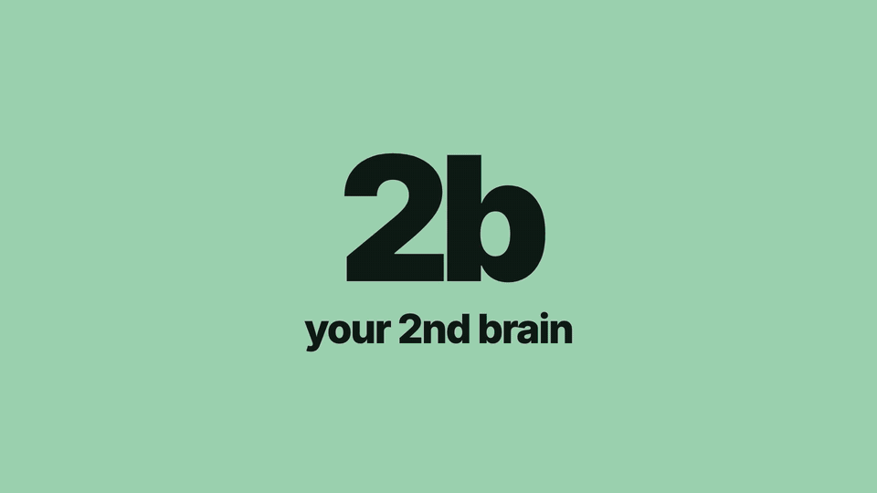

# 2b — your 2nd brain

<p align="center">
  <a href="docs/media/2b-demo.mp4"></a>
  <br><sub><a href="docs/media/2b-demo.mp4">▶ Watch the original demo</a></sub>
</p>

**2b v2.1** is a local CLI and dashboard for projects, tasks, saved knowledge, reminders, and scheduled AI work. Use it yourself or ask your agent to use it.

## The model

- **Project** — a home for related work and knowledge, classified as work or personal.
- **Task** — an action within a project. A normal task runs once as work you track. A recurring task is a scheduled job that runs an agent or command.
- **Collection** — a named group of notes and files within a project. One project can have many collections.
- **Note** — written content in a collection. Types include general, journal, reflection, learning, research, decision, and meeting. A note does not need a task.
- **Artifact** — a file registered in a task, collection, or note, with its purpose and reason.
- **Reminder** — a notification at a time you choose, once or on a repeat schedule. It can live outside projects or link to a project or task. A sent reminder does not complete a task.
- **Event** — a dated log entry. CLI changes and job runs create events. The timeline and weekly report show these records. Work done outside 2b must be logged by you or your agent.

Existing task artifacts, inbox notes, learnings, rules, and jobs continue to work. No data migration is required. New AI jobs default to **Codex**. Existing jobs keep their saved agent choice.

## Install

Requires Node 22.14 or later. Scheduled jobs and desktop notifications require macOS. AI jobs need the selected CLI installed and signed in, network access, and available account usage.

Run from the repository root:

```sh
mkdir -p ~/.local/bin ~/.claude/skills ~/.agents/skills
ln -s "$PWD/bin/2b" ~/.local/bin/2b
ln -s "$PWD/skill" ~/.claude/skills/2b
ln -s "$PWD/skill" ~/.agents/skills/2b
2b init
```

Data lives in `~/obsidian/2b`. Override it with `TWOB_HOME` or `~/.config/2b/config.json` (`{ "home": "/your/path" }`).

If these links already exist, keep them when they point to this checkout. Run `2b --version` to check the installed version. Run `2b help` for all commands. Agents should read [the 2b skill](skill/SKILL.md).

## Projects and tasks

```sh
2b new project sample --area personal --title "Sample" --body "What: Build a tool. Why: Save time. State: Planning."
2b new task sample review --priority high --body "What: Review the design. Why: Check scope. State: Ready."
2b status review doing
2b set review due 2030-01-10
2b ls --tasks --json
2b show review
```

Projects use 🔥 P1 (urgent), ⚡ P2 (high), 🎯 P3 (normal, default), 🌱 P4 (low), and 💤 P5 (someday). Tasks use `high`, `med` (default), or `low`. Lists sort by priority, then date. Give each project and task a body that explains what it is, why it exists, and its current state. Statuses `paused`, `on-hold`, `blocked`, and `dropped` require `--reason`.

## Collections, notes, and output links

```sh
2b new collection sample reflections --title "Weekly reflections" --body "Weekly notes and supporting files."
2b note add sample/collections/reflections 2030-week-01 --title "Week 1" --type reflection --body "What I learned this week."
2b collection ls --project sample
2b note ls sample/collections/reflections
2b show sample/collections/reflections
2b note edit sample/collections/reflections/notes/2030-week-01 --body "Updated reflection."
2b artifact add sample/collections/reflections report.html --about "Weekly report" --why "Keep the supporting results."
```

IDs can be shortened when the result is unique. Use the full ID if several collections or notes share a name. Collections and notes do not have task status or priority. Use `2b set <note> note-type research` to change a note type. Notes are Markdown files. Registered artifacts can be any file type. Existing source files are copied; a name that does not exist creates an empty output file and prints its path.

Set a task or job's output collection with `--output COLLECTION` at creation or `2b set <task> output <collection>`. The collection must belong to the same project. This records the destination; it does not itself write content. AI jobs receive the destination in their instructions. Use `--source TASK` on `note add` or `artifact add` to record where output came from. Notes get `produces` and `produced-by` links. Files also get a resource link from the source task. `2b show` and the dashboard show links in both directions.

## Scheduled AI work

```sh
2b new task sample digest --every "fri 19:00" --output sample/collections/reflections --body "Read the available chat files for the last seven days. Save a reflection note in the output collection with --source set to this task. Include source links."
2b set digest agent claude
2b set digest agent codex
2b schedule ls
2b run digest
```

Schedules support `hourly`, `daily HH:MM`, `weekdays HH:MM`, and selected days such as `mon,fri HH:MM`. Job schedules use the Mac's local time zone.

2b registers active jobs with macOS `launchd`, the system service that starts scheduled programs. At the scheduled time, it starts `2b run <task>`. Agent jobs start `codex exec` by default, or `claude -p` when selected. Command jobs use `--run command --command "..."`.

Each agent run starts a new session with the task body and global, project, and task rules. Specify which chat sources the agent should read. The runner does not give automatic access to every chat service. Runs have a 15-minute limit. Each run saves a log, last run time, and result. A failed run sends a notification.

The terminal and dashboard can be closed. The Mac must be logged in and able to run the job. A calendar job missed during sleep runs after wake. A job missed while the Mac is powered off waits for its next scheduled time. AI jobs currently have no extra catch-up or automatic retry queue.

`2b delete <job>` stops its schedule and moves it to trash. `2b trash ls` lists deleted jobs. `2b restore <trashId>` restores a job as paused; resume with `2b status <job> doing`. Normal tasks cannot be deleted in this release.

## Reminders

```sh
2b reminder add dentist --message "Call the dentist" --at "2030-01-10 10:00" --timezone Asia/Kolkata
2b reminder add journal --message "Write today's journal" --every "daily 21:00" --timezone Asia/Kolkata --project sample
2b reminder add review --message "Review the design" --every "fri 17:00" --timezone Asia/Kolkata --task sample/2030-01-01-review
2b reminder ls
2b reminder show dentist
2b reminder cancel dentist
```

Replace the example task ID with your task's real ID. Give exactly one of `--at` and `--every`. A one-time reminder accepts `yyyy-mm-dd HH:MM` in the selected time zone, or an ISO timestamp with an explicit offset. The default time zone is the Mac's current zone, saved at creation. Repeat schedules use the same formats as jobs, in the reminder's saved time zone. Invalid dates and local times skipped by daylight saving are rejected. For a repeated clock hour, a one-time local time selects its first occurrence; use an explicit offset to select the second.

A reminder worker runs once per minute and on login. It needs no AI CLI and no network. Due reminders are sent when the Mac can run the worker, including after sleep or shutdown. Multiple missed repeat occurrences produce one notification, then advance to the next future time. Delivery can be about one minute late. Notification visibility depends on macOS notification permissions and Focus settings. “Sent” means the notification command succeeded, not that you read it.

Failures are saved and retried on the next worker run. `reminder show` includes history. Cancelled and sent reminders remain in the store. `2b reminder dispatch` checks due reminders manually. `2b schedule sync` repairs schedule registration and reports errors. If registration fails, the reminder remains saved; repair the error and sync again. A process lock prevents concurrent dispatches. A crash after delivery but before saving state can cause a duplicate notification.

## Dashboard

```sh
2b dash --open
```

The local dashboard has Home, Projects, Due, Timeline, Jobs, Collections, Reminders, and Inbox tabs. It supports light and dark themes, search, filters, keyboard shortcuts, and a command palette.

- Home puts overdue and in-progress tasks first. Each group starts with five rows; expand Show more for the rest. Scheduled jobs have their own attention banner.
- Use **New project** in Projects and **New task** inside a project. Use **New job** in Jobs; first-time users are guided to create a project first.
- Use **New collection** or **New note** in Collections. A collection also has its own **New note** action. Notes retain their project, collection, and source context.
- Use **Capture note** in Inbox for a thought or learning. The selected folder is the initial destination. A restored draft keeps the destination you chose.
- Use **New reminder** in Reminders. Jobs and reminders share controls for daily, weekday, selected-day, and hourly schedules. Advanced syntax remains available. Job times use the Mac's local zone; reminders keep their saved zone.
- Search applies to the current page. Collection and Inbox searches include note bodies. Collection results show matching excerpts. Filter controls and choices match the page's data.
- Use Jobs to inspect runs, run a job now, pause it, or restore a deleted job. Source links and backlinks remain available in detail views.

Creation dialogs keep drafts in memory when closed and restore them in the same opening context. Drafts last until page reload; they are not saved notes. Cancel or Escape closes a dialog and returns focus to its button.

On phones, the bottom bar shows Home, Projects, Collections, Reminders, and **More**. More opens Due, Timeline, Jobs, and Inbox.

Use `g c` for Collections and `g r` for Reminders. Press `?` for all shortcuts. The server listens only on the local machine, at port 4422 by default. Use `--port N` for a second store. Restart a running dashboard server after upgrading so it loads the new code.

## Search, history, rules, and import

```sh
2b dump idea --title "An idea"
2b learn lesson --title "A lesson"
2b find "reflection"
2b week --json
2b log review "Finished the design review."
2b rule add global --key sources "Include source links in reports."
2b rules review
2b import scan /path/to/notes
2b check
```

`dump` and `learn` print a Markdown path where you or the agent can write content. Search includes collections and reminders. Timeline and weekly reports include collection, note, and reminder events. Rules apply from global to project to task; a more specific rule with the same key wins. Import copies existing folders without changing the originals; inspect the scan plan before `2b import apply <plan.json>`.

## Store layout

```text
projects/<project>/readme.md
projects/<project>/tasks/<dated-task>/readme.md
projects/<project>/collections/<collection>/readme.md
projects/<project>/collections/<collection>/notes/<note>/readme.md
reminders/<reminder>/readme.md
inbox/<dated-note>.md
learnings/<month>/<dated-note>.md
```

Entries keep their own `log.md`. Job logs live in the task's `runs/` folder. Use the CLI for metadata and history changes. Task rules and artifacts keep their existing paths.

## Development and checks

```sh
npm test
node --check dash/app.js
```

Tests use isolated stores. Scheduler tests avoid installing real jobs, and reminder tests replace desktop delivery. See [the changelog](CHANGELOG.md) for release changes and [the dashboard review](docs/dashboard-ux-review.md) for current UX findings and next steps.

Codex jobs run with `--sandbox workspace-write` in the store. They can run commands and write store files. Claude jobs restrict their allowed tools to the 2b CLI and read tools. Choose the runner and source data that fit the task.
