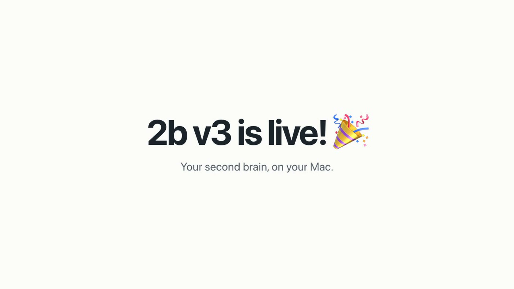

# 2b v3

<p align="center">
  <a href="site/public/2b-v3-demo.mp4"></a>
  <br><sub><a href="site/public/2b-v3-demo.mp4">▶ Watch the 1-minute demo</a> · <a href="https://get2b.vercel.app">get2b.vercel.app</a></sub>
</p>

A local second brain for objects, work, and linked knowledge. Ordinary content files stay readable in Obsidian and Finder. SurrealDB stores properties, relationships, types, and work state.

This checkout is an isolated local V3 preview. It does not replace your global V2 CLI or its schedules.

## Start on this Mac

Double-click **Start 2b V3.command**, or run:

```sh
cd ~/Personal/2b-work3
./bin/2b start
```

The dashboard opens at http://127.0.0.1:4423. Node.js 22 or later is required. No Docker or cloud account is required. The clickable launcher installs the pinned database binary if missing. For terminal setup on a fresh checkout:

```sh
node --experimental-strip-types --no-warnings src/v3/install-surreal.ts
./bin/2b start
```

## Configuration

Run `./bin/2b config` to locate and inspect `~/.2b/config.json`. Edit `vaultPath` to choose your data folder. The initial path is `~/obsidian/2b`. Set primary/fallback agent providers and optional model names under `agents`; a null model uses the installed agent CLI default. The V3 worker is disabled by default.

App state is under `~/.2b`. Each vault has its own database under `~/.2b/vaults/<stable-id>`. A hidden `.2b/vault.json` marker in the content folder keeps identity when that folder moves. Back up both the content folder and the matching database. Changing the configured path to a new folder creates a separate vault.

## CLI examples

```sh
./bin/2b ls --type project --json
./bin/2b capture "An idea to review" --tags learning
./bin/2b object create person "A new contact"
./bin/2b object create project "A finite result" --properties '{"kind":"finite","status":"active"}'
./bin/2b type create course --name Course --schema '[{"key":"progress","type":"number"}]'
./bin/2b object create course "Evaluation course" --properties '{"progress":10}'
./bin/2b link OBJECT_ID mentions PERSON_ID
./bin/2b process OBJECT_ID
./bin/2b check
./bin/2b reconcile
./bin/2b export --out metadata-export.json
```

Use `--root /absolute/vault/path` for any command. `TWOB_V3_HOME` overrides the default vault; `TWOB_APP_HOME` is useful for isolated testing. The old `TWOB_HOME` variable does not redirect V3 into a V2 vault.

## Copy migration

```sh
./bin/2b migrate --dry-run
./bin/2b migrate
```

The source vaults `~/obsidian/2bv2` and `~/obsidian/personal` are read-only. Migration copies their content to V3, preserves originals, builds object relationships and readable note views, and records source hashes and dates. Imported schedules remain disabled pending review. Do not run V2 and V3 versions of the same job simultaneously.

## Checks

```sh
npm test
npm run check
npm run test:v3
npx playwright install chromium
npm run test:browser   # isolated fixture vault; set PLAYWRIGHT_EXECUTABLE_PATH to use an installed Chromium
```

## Dashboard build

The dashboard is React with shadcn/ui. Its built files are in `dash-v3/dist`, and the server serves them, so `./bin/2b start` needs no build step. After you change `dash-v3/src`, rebuild:

```sh
npm install
npm run build
```

`npm run build` type-checks `dash-v3` and writes `dash-v3/dist/index.html` and `dash-v3/dist/assets/`. Node runs the server's stripped TypeScript directly. Read [the V3 architecture](docs/v3-architecture.md), [migration details](src/v3/MIGRATION.md), and [the V2 reference](docs/v2-reference.md).

## Website

The public landing page and the v1, v2, and v3 pages are a Vite and React app in `site/`. Run `npm run dev:site` to work on it and `npm run build:site` to write `site/dist`. Vercel builds it from `vercel.json`; no project settings are needed.

## License

[MIT](LICENSE).
